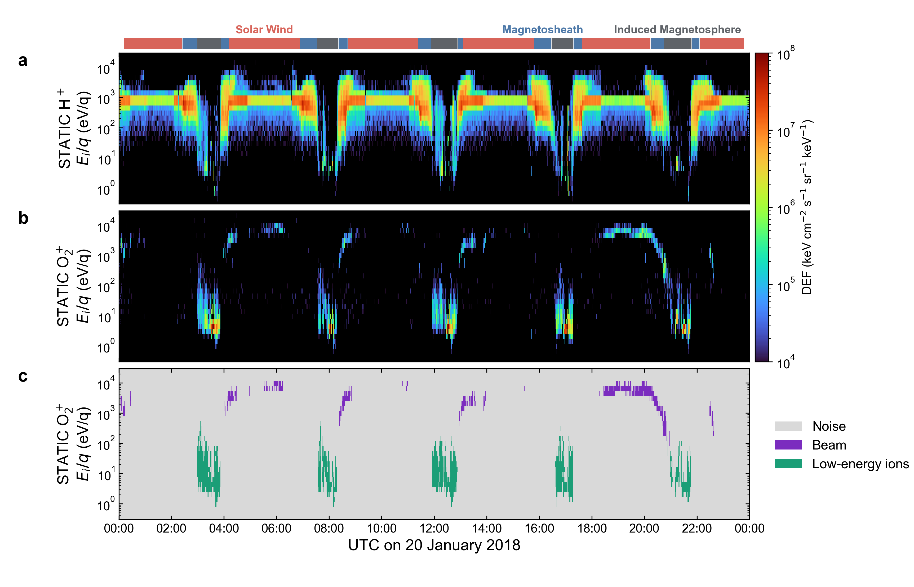
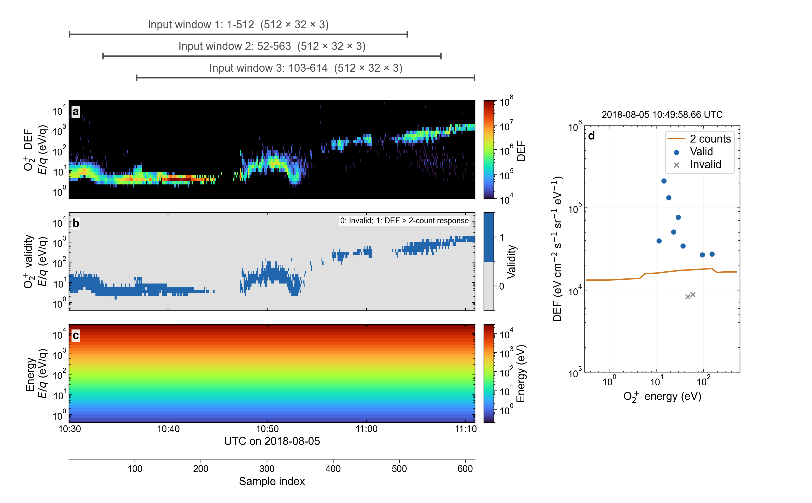
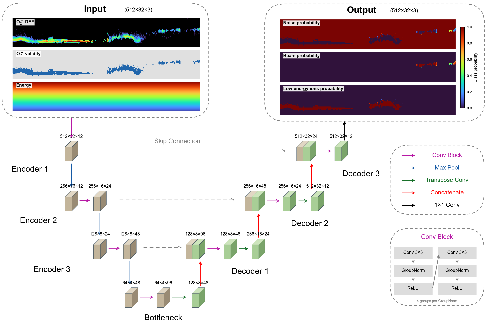

# U-Net Mars O2 Energetic Beams

[](https://doi.org/10.5281/zenodo.24572312)

Inference code and weights for **U-Net v12 count2**, segmenting background-corrected MAVEN STATIC O2+ spectra into Noise, Beam, and Low-energy ions.

Inputs: O2+ log DEF, O2+ validity, normalized log energy.

## Installation and inference

```bash
python -m pip install -r requirements.txt
python -m pip install -e .
python examples/run_example.py --device cpu
python examples/run_example.py --input your_corrected_spectra.npz --output prediction.npz
```

Input NPZ requires `o2_def` with shape `[time,32]` and finite positive `energy_ev` with shape `[32]`. Also supply `two_count_def` with shape `[time,32]`, or binary `o2_validity` computed using the count rule below. Missing count information raises an error. O+ data are not required.

Correct native STATIC C6 backgrounds once using iv4 before summing O2+ mass bins 24 to 40. Interpolate DEF linearly against log10 energy onto the common 32-bin grid. Out-of-range values are NaN. DEF units: keV cm^-2 s^-1 sr^-1 keV^-1. This array API does not read or calibrate raw CDF files.

```python
from unet_mars_o2_beams import build_input_channels, load_pretrained_model, predict_spectrogram
inputs = build_input_channels(o2_def=o2_def, energy_ev=energy_ev, two_count_def=two_count_def)
model, metadata, device = load_pretrained_model("weights/unet_v12_count2_best_validation.pt")
probabilities, labels = predict_spectrogram(model, inputs, device)
```

272,463 parameters; 512 x 32 windows, inference stride 51. Overlapping softmax probabilities are averaged before argmax. Outputs: probabilities `[3,time,32]`, labels `[time,32]`, with 0 Noise, 1 Beam, 2 Low-energy ions. Raw inference does not apply production screening or interval merging.

## Count-based validity

Validity is `isfinite(o2_def) & isfinite(two_count_def) & (two_count_def > 0) & (o2_def > two_count_def)`. Equality is invalid. Log DEF still clips log10 DEF to [4,8] and scales to [0,1], independently of validity.

Compute the simultaneous central O2 mass-channel response at native energy as `2 * dead / (time_integ * geom_factor * gf * eff)`. Use the mass channel nearest 32 amu, the correct sweep/attenuator/efficiency indices, and time-aligned iv4 calibration. Interpolate the response linearly against log10 energy onto the same grid as corrected DEF; out-of-range values are NaN. This is a calibrated count-equivalent threshold, not a comparison of the summed species DEF against the number 2. The array API consumes the calibrated threshold or mask and does not read raw CDFs.

Training preserves inherited physical classes only where this mask is true and assigns other reference pixels to Noise. Raw network outputs remain unconstrained predictions. The architecture is unchanged. The synthetic smoke example uses an illustrative constant threshold and is not instrument calibration.

## Full-day C6 example

The supplied [20 January 2018 example and complete installation guide](examples/C6_EXAMPLE.md) includes background-corrected C6 DEF, raw and background-subtracted counts, calibrated two-count DEF thresholds, current-model predictions, and a reproducible H+/O2+/classification figure. H+ is context only; classification uses O2+.



```bash
python examples/plot_c6_full_day.py
```

## Model figures





[Input figure PDF](docs/v12_count2_inputs.pdf) ¡¤ [Architecture PDF](docs/unet_v12_count2_architecture.pdf)

Reproduce the figures with Python (requires matplotlib and pandas in addition to the inference dependencies):

```bash
python examples/plot_v12_inputs.py
python examples/plot_v12_architecture.py
```

Both figures use the supplied 5 August 2018 corrected STATIC spectra and the count-based validity rule. Physical DEF and energy are shown for interpretation; the model receives normalized channels. The architecture output panels show softmax probabilities for the first 512-sample window. The saved full-interval output averages probabilities across windows starting at samples 1, 52, and 103, then applies argmax. GroupNorm is included after each 3 ¡Á 3 convolution. Source data and calibration snapshot are in `examples/data/`; output provenance is in `docs/v12_count2_figure_method.json`.

## Model and provenance

See [MODEL_CARD.md](MODEL_CARD.md). The training stride recorded in the source checkpoint is 256; the default inference stride is 51. This repository contains the latest model, real-data figure examples, and a synthetic inference example.

## License and citation

Source code and software configuration are licensed under MIT. Trained model files in `weights/` are licensed under [CC BY 4.0](https://creativecommons.org/licenses/by/4.0/). See [LICENSE](LICENSE) and [CITATION.cff](CITATION.cff).

Version 12.0.0 is archived at [Zenodo](https://zenodo.org/records/24572312). Please cite:

Zhang, C. (2026). *U-Net Mars O2+ Beams: inference code and trained model* (Version 12.0.0) [Software]. Zenodo. https://doi.org/10.5281/zenodo.24572312
