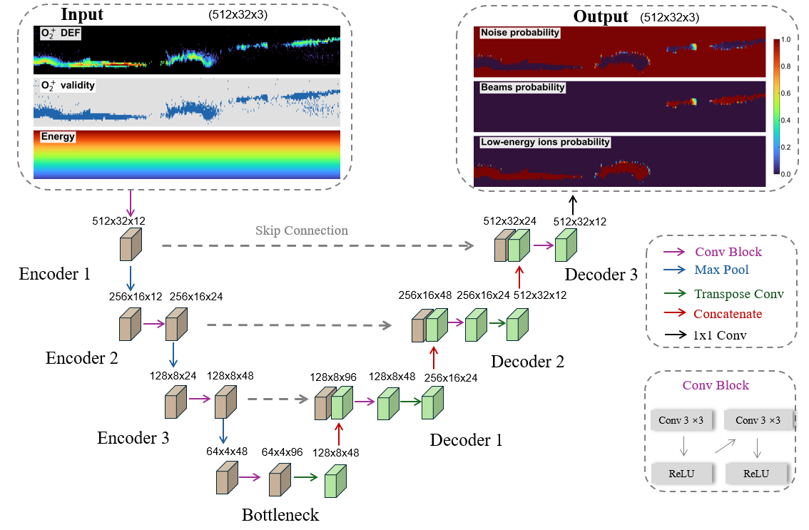
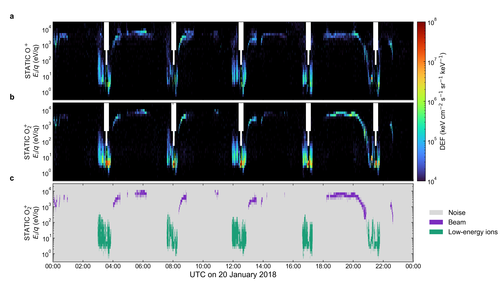

# U-Net Mars O2 Energetic Beams

[](https://doi.org/10.5281/zenodo.23512278)

Inference code and weights for **U-Net v12 count2**, segmenting background-corrected MAVEN STATIC O2+ spectra into Noise, Beam, and Low-energy ions.



Inputs: O2+ log DEF, O2+ validity, normalized log energy. The supplied diagram omits GroupNorm before ReLU.

## Installation and inference

```bash
python -m pip install -r requirements.txt
python -m pip install -e .
python examples/run_example.py --device cpu
python examples/run_example.py --input your_corrected_spectra.npz --output prediction.npz
```

Input NPZ requires `o2_def` with shape `[time,32]` and finite positive `energy_ev` with shape `[32]`. Also supply `two_count_def` with shape `[time,32]`, or binary `o2_validity` computed using the count rule below. Missing count information raises an error. O+ data are not required.

Correct native STATIC C6 backgrounds once using iv4 before summing O2+ mass bins 24 to 40. Interpolate DEF linearly against log10 energy onto the common 32-bin grid. Out-of-range values are NaN. DEF units: keV cm^-2 s^-1 sr^-1 keV^-1. This array API does not read or calibrate raw CDF files. D1 moments are downstream calculations.

```python
from unet_mars_o2_beams import build_input_channels, load_pretrained_model, predict_spectrogram
inputs = build_input_channels(o2_def=o2_def, energy_ev=energy_ev, two_count_def=two_count_def)
model, metadata, device = load_pretrained_model("weights/unet_v12_count2_best_validation.pt")
probabilities, labels = predict_spectrogram(model, inputs, device)
```

272,463 parameters; 512 x 32 windows, stride 256. Overlapping softmax probabilities are averaged before argmax. Outputs: probabilities `[3,time,32]`, labels `[time,32]`, with 0 Noise, 1 Beam, 2 Low-energy ions. Raw inference does not apply production screening or interval merging.

## Count-based validity

Validity is `isfinite(o2_def) & isfinite(two_count_def) & (two_count_def > 0) & (o2_def > two_count_def)`. Equality is invalid. This replaces the v11 fixed DEF >= 1e4 mask. Log DEF still clips log10 DEF to [4,8] and scales to [0,1], independently of validity.

Compute the simultaneous central O2 mass-channel response at native energy as `2 * dead / (time_integ * geom_factor * gf * eff)`. Use the mass channel nearest 32 amu, the correct sweep/attenuator/efficiency indices, and time-aligned iv4 calibration. Interpolate the response linearly against log10 energy onto the same grid as corrected DEF; out-of-range values are NaN. This is a calibrated count-equivalent threshold, not a comparison of the summed species DEF against the number 2. The array API consumes the calibrated threshold or mask and does not read raw CDFs.

Training preserves inherited physical classes only where this mask is true and assigns other reference pixels to Noise. Raw network outputs remain unconstrained predictions. The architecture is unchanged. The synthetic smoke example uses an illustrative constant threshold and is not instrument calibration.

## Historical v11 MAVEN example

```bash
python examples/plot_20180120_full_day.py
python examples/plot_20180120_full_day.py --rerun-inference --device cpu
```

The included 20 January 2018 example contains corrected spectra and reproducible raw v11 labels. Its O+ panel supplies context only; O+ is not used by the classifier.



## Historical v11 beam intervals

[Download 14,484 intervals](catalogs/beam_points_v11_intervals.txt). Three tab-separated columns without a header: sequential ID, start UTC, end UTC. Timestamps retain nanosecond precision. Adjacent retained samples separated by at most 10 minutes are merged. Endpoints are the first and last observed samples.

The curated catalog contains 2,811,946 original v9 samples retained by final v11 screening, with valid MSE and background-corrected D1 moments. No new v11 points are added. Production screening includes H+/O2+ contamination and reviewed exclusions. Integration extends the v11 beam envelope by one native D1 bin at each end. This catalog is distinct from raw network output.

See [MODEL_CARD.md](MODEL_CARD.md).

## License and citation

Source code and software configuration are licensed under MIT. Trained model
files in `weights/` and the event catalog in `catalogs/` are licensed under
[CC BY 4.0](https://creativecommons.org/licenses/by/4.0/). Third-party observational
data retain their original rights and attribution requirements. See [LICENSE](LICENSE).

Version 11.0.0 is permanently archived at
[Zenodo](https://doi.org/10.5281/zenodo.23512278). Please cite:

Zhang, C. (2026). *U-Net Mars O2+ Beams: inference code, trained model, and beam
interval catalog* (Version 11.0.0) [Software]. Zenodo.
https://doi.org/10.5281/zenodo.23512278

The Zenodo DOI above archives v11, not the current v12 count2 model. The historical figure and interval catalog remain v11 products and have not been regenerated with v12.

This repository
contains the current model and the historical interval catalog and example described above; it
does not include the full sample-level moment dataset or all figure source data.
